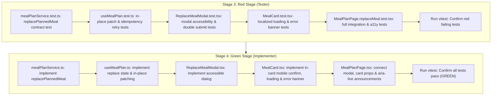

# Implementation Plan: NUT-79 Reemplazar una comida desde su tarjeta

- **Generation Timestamp**: 2026-10-06T18:22:00-03:00
- **Reference Design**: [.plans/nut-79-reemplazar-una-comida-desde-la-tarjeta-del-plan/design.md](file:///C:/Users/Usuario/Documents/projects/nutria-lab-II/.plans/nut-79-reemplazar-una-comida-desde-la-tarjeta-del-plan/design.md)
- **Status**: Proposed

---

## 1. Concrete Files & Symbols

### 1.1 Service Layer

1. [`apps/web/src/services/mealPlanService.ts`](file:///C:/Users/Usuario/Documents/projects/nutria-lab-II/apps/web/src/services/mealPlanService.ts)
   - **Symbol**: `mealPlanService.replacePlannedMeal(planId: string, plannedMealId: string, idempotencyKey: string, body?: Record<string, unknown>, signal?: AbortSignal): Promise<PlannedMeal>`
   - **Contract**:
     - `POST /meal-plans/${planId}/meals/${plannedMealId}/replace`
     - Headers: `{ 'Idempotency-Key': idempotencyKey }`
     - Timeout: `MEAL_PLAN_REQUEST_TIMEOUT_MS` (10,000ms)
     - Response: returns `PlannedMeal` from `response.data` (or extracts `response.data.plannedMeal ?? response.data`).
     - Error handling: propagates error with descriptive fallback.

### 1.2 State Management / Hooks Layer

2. [`apps/web/src/modules/meal-plan/hooks/useMealPlan.ts`](file:///C:/Users/Usuario/Documents/projects/nutria-lab-II/apps/web/src/modules/meal-plan/hooks/useMealPlan.ts)
   - **Symbols**:
     - Type `ReplaceMealError`: `{ mealId: string; message: string; idempotencyKey: string }`
     - Type `UseMealPlanResult`:
       - `mealPlan: MealPlan | null`
       - `status: Status`
       - `errorMessage: string | null`
       - `retry: () => void`
       - `generate: () => Promise<void>`
       - `replacingMealId: string | null`
       - `replaceError: ReplaceMealError | null`
       - `replacePlannedMeal: (planId: string, plannedMealId: string, idempotencyKey?: string) => Promise<PlannedMeal | null>`
       - `retryReplace: () => Promise<PlannedMeal | null>`
       - `cancelReplaceError: () => void`
   - **In-Place Mutation Logic**:
     - On successful response from `mealPlanService.replacePlannedMeal`:
       ```ts
       setMealPlan((prevPlan) => {
         if (!prevPlan) return null;
         return {
           ...prevPlan,
           days: prevPlan.days.map((day) => ({
             ...day,
             meals: day.meals.map((m) => (m.id === plannedMealId ? newMeal : m)),
           })),
         };
       });
       ```
     - Leaves all other days, date strings, and meals completely unaltered.
     - Preserves the same `idempotencyKey` in `replaceError` so `retryReplace` reuses it.

### 1.3 Components Layer

3. [`apps/web/src/modules/meal-plan/components/ReplaceMealModal.tsx`](file:///C:/Users/Usuario/Documents/projects/nutria-lab-II/apps/web/src/modules/meal-plan/components/ReplaceMealModal.tsx) *(New)*
   - **Component**: `ReplaceMealModal({ isOpen, meal, onConfirm, onCancel, isLoading }: ReplaceMealModalProps)`
   - **Semantics & Accessibility**:
     - Accessible modal dialog conforming to WAI-ARIA (`role="dialog"`, `aria-modal="true"`, `aria-labelledby="replace-modal-title"`, `aria-describedby="replace-modal-desc"`).
     - Traps focus and binds Escape key to `onCancel`.
     - Explicit naming: Title states "¿Reemplazar {meal?.recipe?.title}?".
     - Explicit scope: Description states "Solo se cambiará este plato. Las demás comidas de tu plan semanal se mantendrán iguales.".
     - Actions: Secondary button "Cancelar", Primary green button "Reemplazar comida" (disabled when `isLoading` to prevent double-submit).

4. [`apps/web/src/modules/meal-plan/components/MealCard.tsx`](file:///C:/Users/Usuario/Documents/projects/nutria-lab-II/apps/web/src/modules/meal-plan/components/MealCard.tsx)
   - **Component**: `MealCard({ meal, compact, onSwap, onReplace, isReplacing, replaceError }: MealCardProps)`
   - **Behaviors**:
     - **Accessible Trigger**:
       - In `compact` mode (Desktop grid): Replace button (`aria-label={`Reemplazar ${recipe?.title ?? 'comida'}`.trim()}`).
       - In standard mode (Mobile single day view): Replace button with accessible icon and text affordance.
     - **Mobile In-Card Confirmation**:
       - When user clicks replace on mobile, shows an inline card confirmation prompt:
         *"¿Reemplazar {recipe.title}? El resto de tu plan no cambiará."* with "Reemplazar" and "Cancelar".
     - **Loading Overlay**:
       - When `isReplacing === true`: card is locked (`aria-busy="true"`, pointer events disabled on card actions), showing localized spinner / skeleton overlay and "Reemplazando receta...".
     - **Error Banner**:
       - When `replaceError` is present on this card: renders inline error notification with "Reintentar" (calls `replaceError.onRetry`) and "Cancelar" (calls `replaceError.onCancel`), keeping original recipe visible.

5. [`apps/web/src/modules/meal-plan/pages/MealPlanPage.tsx`](file:///C:/Users/Usuario/Documents/projects/nutria-lab-II/apps/web/src/modules/meal-plan/pages/MealPlanPage.tsx)
   - **Updates**:
     - Connects `useMealPlan` replace methods (`replacePlannedMeal`, `replacingMealId`, `replaceError`, `retryReplace`, `cancelReplaceError`).
     - Screen reader announcer: `<div role="status" aria-live="polite" className="sr-only">{announcement}</div>`.
     - Handles desktop modal trigger: clicking replace in desktop grid opens `ReplaceMealModal`.
     - Passes `isReplacing={meal.id === replacingMealId}` and `replaceError` to `MealCard`.
     - Ensures `selectedDate` (query param `?day=...`) and viewport scroll are untouched.

### 1.4 Test Files

1. [`apps/web/src/services/tests/mealPlanService.test.ts`](file:///C:/Users/Usuario/Documents/projects/nutria-lab-II/apps/web/src/services/tests/mealPlanService.test.ts)
   - Test `replacePlannedMeal` dispatches `POST /meal-plans/:planId/meals/:plannedMealId/replace` with header `Idempotency-Key`.
   - Test propagates errors properly.

2. [`apps/web/src/modules/meal-plan/hooks/tests/useMealPlan.test.ts`](file:///C:/Users/Usuario/Documents/projects/nutria-lab-II/apps/web/src/modules/meal-plan/hooks/tests/useMealPlan.test.ts)
   - Test `replacePlannedMeal` replaces exclusively the target meal in state.
   - Test other meals in the same and other days remain intact.
   - Test double-submit prevention while in-flight.
   - Test error retains idempotency key and `retryReplace` reuses it.

3. [`apps/web/src/modules/meal-plan/components/tests/ReplaceMealModal.test.tsx`](file:///C:/Users/Usuario/Documents/projects/nutria-lab-II/apps/web/src/modules/meal-plan/components/tests/ReplaceMealModal.test.tsx) *(New)*
   - Test accessible dialog attributes, meal name display, non-destructive reassurance message.
   - Test confirm and cancel callbacks.
   - Test double-click prevention (disabled while loading).

4. [`apps/web/src/modules/meal-plan/components/tests/MealCard.test.tsx`](file:///C:/Users/Usuario/Documents/projects/nutria-lab-II/apps/web/src/modules/meal-plan/components/tests/MealCard.test.tsx)
   - Test replace action button presence in both compact and regular view.
   - Test localized loading state blocks only the target card.
   - Test error banner rendering with retry and cancel actions.

5. [`apps/web/src/modules/meal-plan/pages/tests/MealPlanPage.replaceMeal.test.tsx`](file:///C:/Users/Usuario/Documents/projects/nutria-lab-II/apps/web/src/modules/meal-plan/pages/tests/MealPlanPage.replaceMeal.test.tsx) *(New)*
   - End-to-end integration test of single meal replacement flow:
     - Confirms replacement names the dish and reassures that rest does not change.
     - Verifies only one meal changes while all others remain identical.
     - Verifies selected day does not change.
     - Verifies screen reader live announcement (`aria-live="polite"`).
     - Verifies double-click prevention.
     - Verifies error and retry with identical idempotency key.

---

## 2. Implementation & TDD Sequence



---

## 3. Verification & Compliance Checklist

- [ ] `POST /meal-plans/:planId/meals/:plannedMealId/replace` with `Idempotency-Key: <uuid>`.
- [ ] No optimistic update with fabricated recipe data.
- [ ] Only the replaced planned meal is modified in memory.
- [ ] Active day index / date query parameter is preserved.
- [ ] Scroll position is preserved (no full page reload or layout reset).
- [ ] Only the target card is locked during replacement; other cards remain navigable.
- [ ] Double-click is prevented; retry reuses the exact same idempotency key.
- [ ] ARIA live region announces initiation, success, and error to screen readers.
- [ ] Responsive behavior: Mobile in-card confirmation + Desktop accessible modal.
