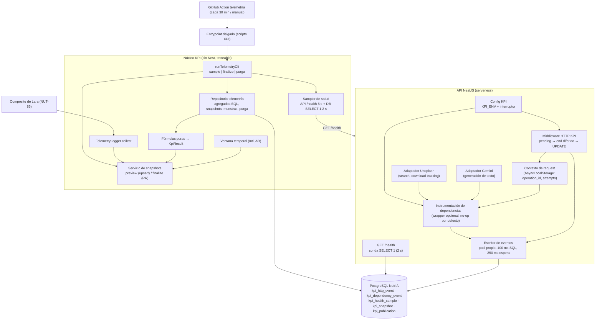

# NUT-85 — Diseño: telemetría, tablas y migración de KPIs

Generado: 2026-10-08 (designer backend). Fuente de verdad: `ticket.md` de esta carpeta (contrato compartido v1). Checklist cubierto: `checklist.md` (A1..J3). Este documento no nombra archivos del repo a propósito; el explorer los ubica en `plan.md`.

---

## 1. Contexto y alcance

**Objetivo.** Medir la salud técnica de la API de NutrIA con datos reales: registrar cada operación HTTP y cada intento contra proveedores externos, tomar muestras de salud cada 30 minutos, calcular los 8 KPIs de Telemetry por ventana diaria (00:00–21:00 Argentina) y entregarlos a Lara (NUT-86) a través de `TelemetryLogger.collect(context)`. Además, crear las CINCO tablas `kpi_*` (incluida la de publicación que usa Lara) en una sola migración aditiva.

**Contexto verificado en el código actual.**
- API NestJS sobre Express, sin prefijo global ni guard global; no existe hoy un endpoint `/health`.
- Prisma 7 con esquema multi-archivo (un archivo de modelos por agregado), cliente generado dentro de `src`, adaptador `@prisma/adapter-pg` sobre un `pg.Pool`. El servicio Prisma de negocio usa `DATABASE_URL` sin timeouts.
- La configuración de Prisma CLI toma `DATABASE_URL_UNPOOLED` **con prioridad** sobre `DATABASE_URL` y carga `.env` con dotenv. Esto es relevante para la seguridad de los tests de migración (ver D17).
- El deploy en Vercel ejecuta `prisma migrate deploy` en el build: **mergear la migración la aplica en el ambiente de ese deploy** (ver D18 y riesgos).
- Llamadas externas reales (únicos puntos de ejecución):
  - Gemini: un único método privado de generación de texto del adaptador de Gemini, con `AbortController` de 15 s. Lo usan la generación inicial, el reemplazo de comida y la regeneración (que puede llamar a Gemini **hasta 2 veces** en la misma request).
  - Unsplash: búsqueda de candidatos (fetch + lectura del body bajo un mismo timeout, con concurrencia acotada a 3) y registro de descarga (`download_location`). Ambas con `AbortController`.
  - No hay otras llamadas de red salientes en `src`.
- Jest: `rootDir` = `src`, sólo corre `*.spec.ts`. Lint = `tsc --noEmit` sobre `src/**`. No hay `supertest`, `js-yaml`, `tsx` ni librerías de fechas con zonas horarias declaradas, y **no se puede modificar `package.json`**.
- Los tipos del contrato v1 ya existen en el módulo KPI (propiedad de Lara, no se modifican).

**Dentro del alcance.** Modelos Prisma + migración; instrumentación HTTP; instrumentación de dependencias (Gemini, Unsplash); `GET /health`; escritor de eventos acotado; calculador de los 8 KPIs; snapshots preview/final; `TelemetryLogger.collect`; lógica del CLI de telemetría (sample/finalize/purga) + entrypoint delgado; workflow de GitHub Actions de telemetría; tests.

**Fuera del alcance.** UI; nuevos KPIs; cambios a columnas de tablas de negocio (sólo índices `createdAt` en planes y recetas); publicación externa, Composite, Data Logger, Publisher, catálogo, `package.json` (todo de Lara); ejecutar migraciones contra bases compartidas.

---

## 2. Decisiones (registro)

Ante ambigüedad se eligió la opción más conservadora según el contrato. Cada decisión es la que el tester y el implementer deben respetar.

**D1 — `KPI_ENV` faltante o inválido en el backend: instrumentación deshabilitada + log técnico, la app arranca.**
- Valores válidos: exactamente `dev`, `qa`, `prod` (sensible a mayúsculas, sin trim ni normalización). Nunca se infiere de `NODE_ENV` ni de otra variable.
- Si falta → la instrumentación (HTTP y dependencias) queda deshabilitada, se emite **una vez al arrancar** un log de nivel error con el código `KPI_ENV_MISSING`; si es inválido → `KPI_ENV_INVALID` (sin imprimir el valor recibido). La app arranca y atiende normalmente; `/health` funciona (no depende de `KPI_ENV`).
- Por qué: el contrato pide "no bloquear indefinidamente el negocio" y "la aplicación funciona si se desactiva instrumentación". Fallar el arranque por una variable de telemetría tiraría el negocio entero; escribir con un ambiente inferido mezclaría datos de ambientes. Deshabilitar es lo único que no inventa datos ni corta el servicio. El log hace visible el problema; el KPI `health_status`/`operations_count` de ese ambiente quedará sin datos (unavailable), que es la señal correcta.
- **En el CLI la regla es la opuesta: `KPI_ENV` faltante, inválido o distinto de `--environment` ⇒ exit 2 sin ninguna escritura** (`KPI_ENV_MISSING`, `KPI_ENV_INVALID`, `KPI_ENV_MISMATCH`). La Action debe fallar visiblemente.

**D2 — Interruptor de apagado (rollback operativo): `KPI_INSTRUMENTATION_ENABLED`.**
- Ausente o `true` ⇒ habilitada (si D1 lo permite). `false` ⇒ deshabilitada. Cualquier otro valor ⇒ deshabilitada + log `KPI_SWITCH_INVALID` (ante duda, apagado).
- Deshabilitada significa: el middleware HTTP es pass-through, el wrapper de dependencias ejecuta la llamada sin registrar nada, el escritor nunca abre conexión ni toca tablas `kpi_*`. Cambiar el valor requiere redeploy (Vercel). `/health` no depende del interruptor.
- El cron se apaga deshabilitando el workflow en GitHub. Las tablas y datos se conservan (no hay migración "down" en ambientes compartidos).

**D3 — Escritor de eventos con pool propio y doble límite.**
- Pool `pg` dedicado y chico (máximo 2 conexiones) sobre `DATABASE_URL`, separado del pool de negocio para que la telemetría nunca consuma conexiones del negocio. Se accede vía un `PrismaClient` propio con el adaptador pg (consistente con "mediante Prisma").
- Límite SQL: `statement_timeout = 100ms` como parámetro de sesión del pool dedicado (no un `SET LOCAL` por escritura, que agregaría 3 round-trips).
- Espera acotada en el proceso: cada escritura se resuelve como máximo en **250 ms** (incluye adquirir conexión: `connectionTimeoutMillis` del pool ≤ 150 ms, `query_timeout` cliente 150 ms y un temporizador de carrera que siempre se limpia).
- Las promesas del escritor **nunca rechazan**: capturan el error, emiten un código técnico (`KPI_WRITE_TIMEOUT`, `KPI_WRITE_FAILED`, `KPI_WRITE_WAIT_EXCEEDED`) con el SQLSTATE si existe, **nunca** el mensaje del error ni la URL de conexión.
- Toda escritura queda registrada en un conjunto de "en vuelo"; un hook de cierre de la app espera (acotado, 1 s) a que se vacíe. No hay promesas sueltas.

**D4 — Instrumentación HTTP como middleware global que difiere el `end` de la respuesta.**
- Un middleware Express aplicado a todas las rutas (también a las no matcheadas, para registrar 404).
- Al entrar: genera el `id` (UUID de aplicación), toma `started_at` (reloj de pared, ms) y una marca monotónica; **espera (acotado) el INSERT `pending`** y recién después llama a `next()` dentro de un contexto de request (AsyncLocalStorage) que expone el `id` como `operation_id` para las dependencias.
- Cierre: se intercepta el `end` de la respuesta. Cuando el handler termina, se calcula el resultado, se **espera (acotado) el UPDATE de cierre** y recién entonces se llama al `end` original. Así, en serverless, la persistencia termina antes de que la respuesta se complete ("espera acotada antes de continuar la respuesta"). El retraso máximo agregado por request es 250 ms al inicio + 250 ms al final.
- Desconexión del cliente: si el socket se cierra antes de que la respuesta termine, se cierra el evento con `network_error` en ese momento; la promesa queda en el registro de la request y el `end` diferido (si llega) la espera antes de seguir.
- Si el runtime mata el proceso antes del cierre, la fila queda `pending` (no se infiere timeout).
- Alternativa descartada: interceptor de Nest. No ve 404 de rutas inexistentes ni errores de guards (401/403), por lo que perdería operaciones.

**D5 — Un solo cierre por id: `UPDATE ... WHERE id = $1 AND outcome = 'pending'`.** Un segundo cierre afecta 0 filas: no crea otra fila ni pisa el primero (log de nivel debug `KPI_CLOSE_NOT_PENDING`). El cierre nunca hace INSERT: si el `pending` no se pudo insertar, el cierre afecta 0 filas y la operación simplemente no queda registrada (preferible a una fila inventada). El cierre se encadena después del INSERT de la misma request.

**D6 — Clasificación HTTP.**
| Condición | outcome | http_status |
|---|---|---|
| status 408 o 504 emitido por nuestro servidor, o evento de timeout del socket del servidor antes de terminar | `timeout` (confirmado) | el status si existe |
| 2xx | `success` | status |
| 4xx (salvo 408) | `client_error` | status |
| 5xx (salvo 504) | `server_error` | status |
| socket cerrado antes de terminar la respuesta | `network_error` | NULL |
| 1xx/3xx u otro | `other` | status |
| sin cierre | `pending` | NULL |

- "Timeout confirmado" = sólo cuando el propio servidor lo señala; jamás se deduce de una fila `pending` vieja. El 503 actual por timeout de IA es `server_error` (no se cambia el comportamiento de negocio).
- `duration_ms` = diferencia monotónica (≥ 0 garantizado). `finished_at` = `started_at + duration_ms` (no un segundo reloj de pared), por lo que `finished_at ≥ started_at` siempre se cumple aunque el reloj del sistema salte.

**D7 — `operation` = método + plantilla de ruta.** Ej.: `POST /meal-plans/:planId/regenerate`. Se arma con la ruta base + la ruta declarada que matcheó (nunca la URL real), sin query, sin barra final, truncada a 200 caracteres. Si no matcheó ninguna ruta: el valor fijo `UNMATCHED`. El INSERT `pending` se hace antes del ruteo, así que lleva el valor fijo `UNRESOLVED`; el UPDATE de cierre lo reemplaza por la plantilla. Una fila que nunca cierra queda con `UNRESOLVED` (sin PII).

**D8 — Exclusiones de tráfico.** No se instrumentan: `/health` (cualquier método), cualquier ruta bajo el prefijo reservado `/kpi` (reporting; hoy no existe ninguna) y las preflight CORS (`OPTIONS`). Lo último no está en el contrato; se excluye porque no es una operación de negocio y su inclusión dependería del orden de registro de middlewares (inflaría `operations_count` con éxitos de 0 ms). Documentado como desvío menor.

**D9 — Dependencias: wrapper en el punto de ejecución, attempt por request.**
- Nombres cerrados de `dependency`: `gemini`, `unsplash_search`, `unsplash_download`.
- Se envuelve **sólo** el método que ejecuta la llamada de red (el de generación de texto de Gemini; el fetch de búsqueda y el de tracking de Unsplash). Las capas superiores (composer, servicios de plan, servicio de imágenes) no se instrumentan.
- `operation_id` = `id` del evento HTTP de la request actual (AsyncLocalStorage). Fuera de una request (scripts operativos) se genera un UUID nuevo por invocación.
- `attempt` = contador por (`operation_id`, `dependency`) en el contexto de la request, incrementado **sincrónicamente** al iniciar cada llamada (seguro con la concurrencia 3 de Unsplash). Las 2 llamadas a Gemini de una regeneración son `attempt` 1 y 2 del mismo `operation_id`.
- Outcome: `success` si la llamada devolvió respuesta útil (Unsplash 2xx, incluida una búsqueda sin resultados); `timeout` si se disparó el abort por el timeout propio del adaptador; `error` en cualquier otro caso (red, status no 2xx, error del SDK). Si el adaptador decide **no** llamar (falta la API key, cuota agotada localmente, URL inválida) no hay fila: no hubo intento.
- Mismo ciclo pending → UPDATE con el mismo escritor y límites. Nunca se guarda URL, query, título de receta ni claves.
- La instrumentación de dependencias es una dependencia **opcional** de los adaptadores (por defecto no-op) para que las construcciones manuales existentes (tests y scripts operativos) sigan funcionando sin cambios.

**D10 — `GET /health` con sonda de DB aislada.**
- `SELECT 1` en una conexión dedicada con `connectionTimeoutMillis`, `query_timeout` y `statement_timeout` de 2000 ms, más un deadline total de 2 s; la conexión se libera siempre en `finally`.
- 200 `{"status":"ok","database":"ok"}` / 503 `{"status":"error","database":"error"}` exactamente; `Cache-Control: no-store`. Nunca incluye mensaje de excepción, stack ni credenciales. No invoca IA ni depende de módulos de IA. Sin autenticación.
- Excluido del tráfico (D8). Funciona aunque la instrumentación esté apagada o `KPI_ENV` falte.

**D11 — Ventana temporal sin dependencias nuevas.** Zona `America/Argentina/Buenos_Aires` resuelta con `Intl` (offset por instante, no un `-03:00` fijo, por si cambia la regla). `start` = 00:00 local de D, `end` = 21:00 local de D, en UTC con milisegundos.
- Finalize/collect sin fecha: D = fecha local de hoy si la hora local ≥ 21:00, si no ayer ("último corte que ya pasó"). Un atraso del scheduler no cambia D salvo que cruce otro corte de las 21:00.
- Fecha explícita: formato `YYYY-MM-DD` y fecha de calendario real; si `end(D) > now` ⇒ rechazo `FUTURE_CUT` (exit 2).
- Sample: D por defecto = fecha local actual; `end` = min(now, 21:00 D); si `start(D) > now` ⇒ `FUTURE_DATE` (exit 2) validado **antes** de tomar la muestra; si `end ≤ start` sólo se guarda la muestra.

**D12 — Cálculo: agregados en SQL, fórmulas en TypeScript puro.** Un repositorio devuelve agregados (conteos por outcome, `percentile_disc(0.95)`, máximos de tiempo) en consultas parametrizadas; funciones puras convierten agregados → `KpiResult`. Sin cargar colecciones en memoria. Valores sin redondeo (66.666… se guarda tal cual). Un valor no finito lanza un error de programación (`KPI_NON_FINITE`), nunca se convierte en unavailable.

**D13 — Previews: upsert por corte; finales: insert-only.**
- Preview: los 8 en una transacción `INSERT ... ON CONFLICT (environment, report_date, window_end, snapshot_kind, kpi_id) DO UPDATE` (valor, calidad, motivo, sample_count, measured_at). Idempotente por corte (nunca duplica) y permite "recomputar previews históricos" que pide el ticket. Cortes distintos coexisten.
- Final: nunca se actualiza ni se hace upsert. Inmutabilidad garantizada por el código (insert-only en REPEATABLE READ) y por la UNIQUE. No se agregan triggers (el contrato fija CHECK/UNIQUE/índices como mecanismo; un trigger también afectaría los UPDATE condicionales de Lara en otra tabla si se generalizara).

**D14 — Finalize en REPEATABLE READ con INSERT plano y reintento de lectura.**
1. Transacción `REPEATABLE READ`.
2. Leer finales de (environment, report_date, window_end). 8 ⇒ devolverlos sin recalcular. Entre 1 y 7 ⇒ error de integridad `KPI_FINAL_INCOMPLETE` (no debería existir: siempre se insertan juntos).
3. 0 ⇒ calcular agregados **en el mismo snapshot**, armar los 8 y hacer un INSERT plano (sin `ON CONFLICT`).
4. Si otra finalización ganó: el INSERT falla por UNIQUE (23505) o serialización (40001). Rollback completo (ningún final mezclado) y nueva transacción, que lee los 8 del ganador y los devuelve. Máximo 3 transacciones; agotadas ⇒ error `KPI_FINALIZE_CONFLICT`.
- Por qué no `ON CONFLICT DO NOTHING`: en REPEATABLE READ igual puede dar 40001 y además permitiría completar "lo que faltaba", abriendo la puerta a una mezcla de corridas.
- Finalize no toma muestra de salud ni fabrica una con timestamp de las 21:00.

**D15 — `collect(context)` = validación + el mismo núcleo de finalize + traducción de fallas de fuente.**
- Valida: `contract_version === '1'`; `environment` igual al `KPI_ENV` del proceso (si no, `KPI_ENV_MISMATCH`); `window_start`/`window_end` iguales a los canónicos de `date` (si no, `KPI_CONTEXT_WINDOW_MISMATCH`); corte ya ocurrido (si no, `FUTURE_CUT`). Estas violaciones son errores de contrato/programación: **se propagan**.
- Ejecuta el núcleo de finalize (D14). Devuelve exactamente los 8 códigos de Telemetry, ordenados por `kpi_id`, con `measured_at` del cálculo original si se reutilizan.
- Falla esperable de la fuente (DB caída, timeout de conexión, conflicto agotado): devuelve los 8 con `quality='unavailable'`, `value=null`, `reason='SOURCE_UNAVAILABLE'`, `sample_count=0`, `measured_at` = ahora, **sin persistir nada** (un reintento posterior puede calcular valores reales). El contrato asigna esta traducción a la fuente; no hay defaults numéricos acá (los aplica el Composite de Lara).
- El CLI `finalize` usa el núcleo directamente (sin traducción): DB caída ⇒ exit 1.

**D16 — Purga trimestral conservadora.**
- No hace nada si la fecha local de hoy es anterior a 2027-01-01.
- Corte de purga = el más temprano entre (a) el primer día del trimestre local actual y (b) el día en preparación (D del último corte que ya pasó). Se borran sólo filas del ambiente de la corrida y anteriores a ese corte: eventos HTTP y de dependencia por `started_at`, muestras por `scheduled_for`, snapshots por `report_date`.
- `DELETE ... WHERE id IN (SELECT id ... LIMIT 1000)` en bucle hasta 0 filas, con un tope de 100 lotes por corrida (el resto queda para la siguiente). Nunca toca `kpi_publication` ni tablas de negocio.
- Corre sólo en modo `sample`, después de la muestra y los previews. Una falla de purga ⇒ exit 1 (la muestra ya quedó guardada).

**D17 — Tests de integración con Postgres real, aislados y con guardas.**
- Sólo leen `KPI_TEST_DATABASE_URL`. Si no está definida, la suite hace skip limpio (`describe.skip`), de modo que `pnpm --filter api test` pasa sin DB.
- Guarda de seguridad: si el host no es `localhost`, `127.0.0.1` o `::1`, la suite **falla** con un mensaje claro (nunca se corre contra Neon u otra base compartida).
- Ni los tests ni el código KPI cargan `.env` (no importan dotenv). Los tests nunca invocan el CLI de Prisma: aplican los `migration.sql` en orden lexicográfico con `pg` dentro de un **schema descartable por suite** (`kpi_it_<aleatorio>`, vía `search_path`) y lo borran con `DROP SCHEMA ... CASCADE` al final. Así suites paralelas no chocan.
- Por eso el SQL del módulo KPI usa nombres de tabla sin calificar (respeta `search_path`).
- La evidencia de `prisma migrate deploy` (A4) se toma a mano sobre el Postgres desechable local, seteando **explícitamente** `DATABASE_URL` y `DATABASE_URL_UNPOOLED` al mismo URL local en el comando (la config de Prisma prioriza `UNPOOLED` y dotenv no pisa variables ya definidas). Nunca contra el `.env` de la API.

**D18 — Una sola migración aditiva, CHECK escritos a mano.** Ver §5. Generada sin tocar bases compartidas (diff de esquema o `--create-only` contra el Postgres desechable con ambas variables explícitas), luego se le agregan los CHECK a mano en el mismo archivo SQL. Como Vercel aplica migraciones en el build, **el merge requiere aprobación humana del TL** (Commit 1 del protocolo de dos commits).

**D19 — Columnas y tipos Prisma.** Modelos `KpiHttpEvent`, `KpiDependencyEvent`, `KpiHealthSample`, `KpiSnapshot`, `KpiPublication` con `@@map` a los nombres del contrato y campos camelCase con `@map` a columnas snake_case. IDs `String @id @db.Uuid` **sin default** (los genera la aplicación con `crypto.randomUUID()`). `sample_count` → `BigInt`; `http_status` → `Int @db.SmallInt`; `updated_at` con `@default(now())` y **sin** `@updatedAt` (Lara lo setea explícitamente; `@updatedAt` sólo funciona vía cliente Prisma y no se refleja en SQL). Nombres de constraints e índices explícitos y estables (los tests los consultan).

**D20 — Formato de `payload_sha256`: 64 hex en minúscula** (`^[0-9a-f]{64}$`), que es lo que produce `digest('hex')` de Node. Además `frozen_batch` y `payload_sha256` son ambos NULL o ambos NOT NULL.

**D21 — CHECKs de consistencia adicionales (más estrictos que el texto, compatibles con el contrato).**
- HTTP: `pending` ⇒ `http_status` NULL; `success` ⇒ 200–299; `client_error` ⇒ 400–499; `server_error` ⇒ 500–599; `operation` de 1 a 200 caracteres.
- Salud: `unknown` ⇒ al menos un booleano NULL y ninguno `false` (si hay un `false` es `unhealthy`); `scheduled_for` alineado a 30 min; `measured_at ≥ scheduled_for`.
- Snapshot: `kpi_id` ∈ los 8 de Telemetry; el valor observado debe ser `< 'Infinity'` (en Postgres esto también excluye `NaN`).

**D22 — CLI: lógica en el módulo, entrypoint delgado.** El entrypoint (en el directorio de scripts KPI de la API, fuera de `src`) sólo lee `process.argv`/`process.env`, llama a una función `runTelemetryCli(argv, env, deps)` del módulo KPI que devuelve el código de salida, y hace `process.exitCode = code` tras esperar. Como lint/tsc sólo cubren `src`, el entrypoint no contiene lógica. El módulo KPI usa imports relativos (no el alias `@/`) para que funcione igual desde Nest, Jest y `tsx`. El CLI no levanta la app Nest (no requiere `GEMINI_API_KEY` ni otras variables de negocio) y no carga `.env`.

**D23 — Códigos de salida del CLI.** `0` éxito (incluye bucket ya registrado). `1` falla de telemetría (DB caída, escritura fallida, finalize en conflicto, purga fallida). `2` uso/configuración (argumentos inválidos, `KPI_ENV` faltante/inválido/distinto, `KPI_API_BASE_URL` faltante en sample, fecha futura).

**D24 — Diagnóstico JSON siempre escrito (best effort, en `finally`).** Ruta por `--diagnostics-out` (el workflow apunta a un directorio temporal del runner, nunca dentro del repo). Contenido: herramienta, modo, ambiente, `report_date`, `window_start`/`window_end`, bucket, resultado de la muestra (`outcome`, `inserted` true/false, motivo), por KPI `{kpi_id, kind, value, quality, reason, sample_count}`, conteos (`http_terminal`, `http_pending_incomplete`, `dependency_attempts`, `health_samples`), purga (`executed`, corte, filas borradas por tabla), lista de códigos de error, `exit_code`, timestamps de la corrida. Nunca URLs, credenciales, mensajes de excepción, rutas reales ni datos de usuario.

**D25 — Reejecutar un bucket ya registrado no hace nada nuevo (agregada en T5).** Si `sample` encuentra su bucket de 30 min ya guardado (ON CONFLICT DO NOTHING no inserta), el CLI sale con exit 0 sin preview ni purga y el diagnóstico registra `preview.skip_reason = SAMPLE_BUCKET_ALREADY_RECORDED`. Es la opción conservadora: la corrida original del bucket ya hizo su preview y su purga, y así una reejecución no crea otro corte de preview. Cubierto por `telemetry-cli.integration.spec.ts` ("sample: reejecutar el bucket…"). **No aplica con `--date` explícito** (actualizado post-review): `sample --date D` recalcula igual el preview de D aunque el bucket actual ya esté registrado.

**D26 — Pool propio para reporting (agregada en T5).** Las transacciones de finalize/preview/purga usan un pool separado del escritor de eventos (máx. 3 conexiones, connect 5 s, query 30 s del lado cliente), sin `statement_timeout` en el arranque de la conexión (evita el riesgo del pooler de Neon) y respetando `options`/`search_path` de la URL. Los errores reales de Prisma/adapter se normalizan a `23505`/`40001` (también P2002/P2034) para el reintento acotado de finalize.

**D27 — Sin `statement_timeout` de arranque; `SET LOCAL` por escritura (agregada post-review, hallazgo CRITICAL).** El pooler PgBouncer de Neon puede rechazar parámetros de startup, así que ni el pool del escritor KPI ni la conexión de la sonda de `/health` mandan `statement_timeout`. Cada escritura del escritor (insert/cierre HTTP y de dependencia) corre en su propia transacción batch con `SET LOCAL statement_timeout = '100ms'` antes de la escritura; el límite muere con la transacción y no queda pegado a la conexión. Se mantienen la espera acotada de 250 ms, `57014` ⇒ `KPI_WRITE_TIMEOUT`, `query_timeout` y el connect timeout del cliente.

**D28 — `/health` single-flight con caché corta (agregada post-review).** Requests concurrentes comparten una sola sonda (una conexión) y el resultado (ok o error/timeout) se reutiliza durante `HEALTH_RESULT_TTL_MS = 5000`; vencida la ventana se vuelve a sondear. Bodies 200/503, `Cache-Control: no-store` y el límite de 2 s por request (contado desde que llegó cada request) no cambian.

**D29 — Fechas purgadas y corte de purga ≤ D−1 (agregada post-review).** `TelemetryLogger.collect` con `report_date` anterior a `computePurgeCutoff(now)` devuelve los 8 finales si existen; si no, 8 `unavailable` con reason `PURGED_WINDOW`, sin recalcular ni insertar (los eventos ya no existen). `finalize --date` de una fecha purgada ⇒ exit 2, `PURGED_WINDOW` en `error_codes`, sin efectos. El corte de purga es el menor entre el primer día del trimestre local y el día **anterior** al día en preparación (≤ D−1 00:00 local), para no borrar el último éxito previo al start de D en el cambio de trimestre.

**D30 — Clasificación de errores revisada (agregada post-review).** HTTP 408 es `client_error` (un 4xx nunca es timeout; `timeout` queda para 504 o el timeout confirmado del servidor). En `TelemetryLogger`, los errores de programación/estructura —SQLSTATE clase 42 y clase 23 salvo `23505`, crudos de pg, envueltos por Prisma (P2010 + `meta.code`) o por adapter-pg (`cause.originalCode`)— se propagan; conexión/timeout (`08xxx`, `57014`, `ETIMEDOUT`…) y conflictos agotados siguen como `SOURCE_UNAVAILABLE`.

**D31 — Instrumentación apagada no se publica como observed 0 (Fix 1, post-review).** `GET /health` agrega el header `X-KPI-Instrumentation: enabled|disabled` según la config KPI efectiva (`disabled` si `enabled=false` por cualquier motivo: `KPI_ENV` faltante/inválido o switch apagado/inválido), también en 503 y en respuestas reutilizadas por single-flight/caché; body y status no cambian. El CLI `sample` lee el header: con `disabled` guarda la muestra igual (misma salud, mismos `api_ok`/`database_ok`/`outcome`) con `reason = 'INSTRUMENTATION_DISABLED'`. Decisión conservadora: si la muestra además es `unhealthy`, igual se guarda `INSTRUMENTATION_DISABLED` (una sola columna `reason`, sin cambiar el esquema) y el detalle de la falla queda en `api_ok`/`database_ok`. Header ausente o desconocido = backend viejo ⇒ no se marca nada (reason como antes). Fórmulas: `TelemetryAggregates.instrumentationDisabledSamples` cuenta las muestras del ambiente con `measured_at` en [start, end) y esa reason; si es > 0, `operations_count`, `error_rate`, `timeout_rate`, `latency_p95_ms`, `last_success_age_seconds` y `dependency_error_rate` salen `unavailable`/`INSTRUMENTATION_DISABLED` (value null, sample_count 0); `health_status` y `availability_rate` no cambian. Con 0 muestras así, todo igual que antes (F1–F7). Sin cambios de migración ni de `kpi.prisma`.

**D32 — Timeout de conexión del escritor separado del de consulta (Fix 2, arranque en frío).** El pool dedicado del escritor KPI (D3) usa `connectionTimeoutMillis = KPI_CONNECT_TIMEOUT_MS = 1500` en lugar de 150 ms: en Vercel+Neon abrir una conexión nueva suele superar 150 ms, el insert `pending` fallaba, el UPDATE de cierre afectaba 0 filas y la request no quedaba registrada (subconteo silencioso). `query_timeout` sigue en 150 ms (`KPI_CLIENT_TIMEOUT_MS`), el `SET LOCAL statement_timeout` de 100 ms por escritura (D27) no cambia y sigue sin `statement_timeout` de arranque (PgBouncer). El negocio sigue protegido por la espera acotada de 250 ms (`KPI_WRITE_WAIT_MS`, sin cambios): si la conexión tarda, la respuesta sale igual, la escritura termina en vuelo y el cierre espera al insert `pending` del mismo id, quedando una sola fila terminal. Límite conocido: el drain del cierre de la app está acotado a 1 s, así que al apagar puede no esperar una conexión que tarde hasta 1,5 s (esa escritura puede perderse; no afecta al negocio). Sin cambios de migración ni de `kpi.prisma`.

---

## 3. Arquitectura

**Capas y responsabilidades.**
- **Config KPI**: resuelve una vez `KPI_ENV` + interruptor ⇒ `{ enabled, environment | null, disabledReason }`. Se inyecta; los tests la construyen a mano.
- **Escritor de eventos**: `insertHttpPending`, `closeHttp`, `insertDependencyPending`, `closeDependency`. Todas devuelven `Promise<void>` que nunca rechaza y resuelve en ≤ 250 ms. Interfaz para fakes en unit tests.
- **Middleware HTTP** y **wrapper de dependencias**: lógica de clasificación en funciones puras (`classifyHttpOutcome`, `normalizeOperation`, `classifyDependencyOutcome`) testeables sin red.
- **Núcleo KPI**: clases con dependencias por constructor (cliente DB, reloj `now()`, logger), sin decoradores obligatorios, envueltas como providers en el módulo Nest para `collect` y `/health`. El CLI las construye directamente.
- **Módulo KPI de Nest**: global; registra el middleware, provee config, escritor, contexto, wrapper de dependencias, controller de health y `TelemetryLogger`.

**Contrato con Lara.** `TelemetryLogger` implementa `KpiLogger` del contrato v1 sin modificarlo. Lara lee `kpi_publication` y escribe allí; Majo sólo crea la tabla.

---

## 4. Configuración

| Variable | Dónde | Regla |
|---|---|---|
| `DATABASE_URL` | API, CLI, Action (secret) | Obligatoria. Nunca se imprime. |
| `KPI_ENV` | API, CLI, Action (variable del Environment) | `dev`/`qa`/`prod`. API: faltante ⇒ D1. CLI: faltante/≠ `--environment` ⇒ exit 2. |
| `KPI_INSTRUMENTATION_ENABLED` | API | D2. |
| `KPI_API_BASE_URL` | CLI/Action (variable) | Obligatoria en `sample`; se le agrega `/health`. Nunca se imprime. |
| `KPI_TEST_DATABASE_URL` | Sólo tests | D17. Local: Postgres desechable en `localhost:55432`. |

La Action no recibe `DATABASE_URL_UNPOOLED`, `PROJECT_KEY` ni variables de Supabase (no las necesita).

---

## 5. Base de datos, Prisma y migración

### 5.1 Tablas (todas con prefijo `kpi_`, sin FK, sin PII)

**`kpi_http_event`**
- Columnas: `id uuid PK`, `environment text NOT NULL`, `operation text NOT NULL`, `started_at timestamptz(3) NOT NULL`, `finished_at timestamptz(3) NULL`, `duration_ms double precision NULL`, `http_status smallint NULL`, `outcome text NOT NULL`, `recorded_at timestamptz(3) NOT NULL DEFAULT now()`.
- CHECK: `environment IN ('dev','qa','prod')`; `outcome IN ('pending','success','client_error','server_error','network_error','timeout','other')`; `duration_ms IS NULL OR (duration_ms >= 0 AND duration_ms < 'Infinity')`; `http_status IS NULL OR http_status BETWEEN 100 AND 599`; `finished_at IS NULL OR finished_at >= started_at`; ciclo de vida: `(outcome = 'pending' AND finished_at IS NULL AND duration_ms IS NULL AND http_status IS NULL) OR (outcome <> 'pending' AND finished_at IS NOT NULL AND duration_ms IS NOT NULL)`; consistencia de status por outcome (D21); `char_length(operation) BETWEEN 1 AND 200`.
- Índices: `(environment, finished_at)`, `(environment, outcome, finished_at)`, `(environment, started_at)`.

**`kpi_dependency_event`**
- Columnas: `id uuid PK`, `environment text NOT NULL`, `operation_id uuid NOT NULL`, `dependency text NOT NULL`, `attempt integer NOT NULL`, `started_at`, `finished_at NULL`, `duration_ms NULL`, `outcome text NOT NULL`, `recorded_at DEFAULT now()`.
- CHECK: ambiente; `outcome IN ('pending','success','error','timeout')`; `attempt >= 1`; `char_length(dependency) BETWEEN 1 AND 64`; mismas reglas de duración/fechas/ciclo de vida que HTTP.
- UNIQUE `(environment, operation_id, dependency, attempt)`. Índices `(environment, finished_at)`, `(environment, outcome, finished_at)`.

**`kpi_health_sample`**
- Columnas: `id uuid PK`, `environment`, `scheduled_for timestamptz(3) NOT NULL`, `measured_at timestamptz(3) NOT NULL`, `api_ok boolean NULL`, `database_ok boolean NULL`, `outcome text NOT NULL`, `reason text NULL`.
- CHECK: ambiente; `outcome IN ('healthy','unhealthy','unknown')`; `healthy` ⇒ `api_ok IS TRUE AND database_ok IS TRUE`; `unhealthy` ⇒ `api_ok IS FALSE OR database_ok IS FALSE`; `unknown` ⇒ `(api_ok IS NULL OR database_ok IS NULL) AND api_ok IS NOT FALSE AND database_ok IS NOT FALSE`; alineación a 30 min (`extract(epoch from scheduled_for)` múltiplo de 1800); `measured_at >= scheduled_for`.
- UNIQUE `(environment, scheduled_for)`. Índice `(environment, measured_at)`.

**`kpi_snapshot`**
- Columnas: `id uuid PK`, `environment`, `report_date date NOT NULL`, `window_start`, `window_end`, `snapshot_kind text NOT NULL`, `kpi_id text NOT NULL`, `value double precision NULL`, `quality text NOT NULL`, `reason text NULL`, `sample_count bigint NOT NULL`, `measured_at timestamptz(3) NOT NULL`.
- CHECK: ambiente; `snapshot_kind IN ('preview','final')`; `kpi_id IN` (los 8 de Telemetry); `quality IN ('observed','unavailable')`; `sample_count >= 0`; `window_start < window_end`; `observed` ⇒ `value IS NOT NULL AND value >= 0 AND value < 'Infinity'`; `unavailable` ⇒ `value IS NULL AND reason IS NOT NULL AND char_length(btrim(reason)) > 0`; `kpi_id IN ('error_rate','timeout_rate','dependency_error_rate','availability_rate')` ⇒ `value IS NULL OR value <= 100`; `kpi_id = 'health_status'` ⇒ `value IS NULL OR value IN (0, 1)`.
- UNIQUE `(environment, report_date, window_end, snapshot_kind, kpi_id)`. Índice `(environment, report_date, snapshot_kind)`.

**`kpi_publication`** (la usa Lara)
- Columnas: `run_id uuid PK`, `environment`, `report_date date`, `window_start`, `window_end`, `status text NOT NULL`, `frozen_batch jsonb NULL`, `payload_sha256 text NULL`, `source_commit text NOT NULL`, `retry_chain_id uuid NOT NULL`, `attempt_count integer NOT NULL DEFAULT 0`, `last_error text NULL`, `created_at`/`updated_at timestamptz(3) NOT NULL DEFAULT now()`, `accepted_at NULL`, `delivered_at NULL`.
- CHECK: ambiente; `status IN ('preparing','frozen','accepted','delivered','failed')`; `attempt_count BETWEEN 0 AND 3`; `window_start < window_end`; `payload_sha256 IS NULL OR payload_sha256 ~ '^[0-9a-f]{64}$'`; `(frozen_batch IS NULL) = (payload_sha256 IS NULL)`; `status IN ('frozen','accepted','delivered')` ⇒ lote y hash NOT NULL; `status IN ('accepted','delivered')` ⇒ `accepted_at IS NOT NULL`; `status = 'delivered'` ⇒ `delivered_at IS NOT NULL`.
- UNIQUE `(environment, report_date)`. Índice `(status, updated_at)`.

### 5.2 Índices sobre tablas de negocio
- `meal_plans(createdAt)` y `recipes(createdAt)`: `@@index([createdAt])` en esos dos modelos. Es el **único** cambio en modelos de negocio. El índice por `generationRunId` de planes ya existe.
- `CREATE INDEX` (no `CONCURRENTLY`, porque Prisma corre la migración en transacción): bloquea escrituras de esas tablas durante la creación; con el volumen actual es de milisegundos. Documentado como riesgo aceptado.

### 5.3 Prisma
- Un archivo de modelos dedicado a KPI dentro del esquema multi-archivo, con los 5 modelos (D19): tipos `@db.Timestamptz(3)`, `@db.Date`, `@db.Uuid`, `@db.DoublePrecision`, `@db.JsonB`, `@db.SmallInt`; `@@id`/`@id`, `@@unique` e `@@index` con `map:` explícito igual al nombre en SQL; sin relaciones.
- Enumeraciones como `String` (no `enum` de Prisma): el contrato pide text + CHECK.
- Tras el cambio, `prisma generate` debe pasar y `prisma migrate diff` entre migraciones y esquema no debe mostrar drift (los CHECK son invisibles para Prisma; los índices/uniques sí deben coincidir por nombre).

### 5.4 La migración
- **Una sola** carpeta de migración posterior a la última existente, con nombre `<timestamp>_add_kpi_telemetry`.
- Contenido: 5 `CREATE TABLE` con PK, 4 UNIQUE, índices de §5.1, todos los CHECK con nombres `kpi_<tabla>_<regla>_check`, y los 2 `CREATE INDEX` sobre `createdAt`.
- Prohibido en el SQL: `DROP`, `ALTER TABLE ... DROP/ALTER COLUMN/RENAME`, `TRUNCATE`, `DELETE`, `UPDATE`, cualquier `ALTER TABLE` sobre tablas de negocio (sólo `CREATE INDEX` sobre ellas), extensiones nuevas, triggers.
- Generación: D18. Nunca `migrate dev`/`deploy`/`reset`/`db push`/seed contra el `.env` ni bases compartidas.

### 5.5 Verificación y rollback
- Tests de integración (D17): (a) schema vacío ⇒ aplicar todas las migraciones ⇒ verificar tablas, columnas/tipos, constraints (por nombre en `pg_constraint`), índices (`pg_indexes`); (b) schema con datos ⇒ aplicar migraciones previas, insertar datos sintéticos de NutrIA (usuarios, recetas, planes), contar, aplicar la de NUT-85, volver a contar y comparar filas byte a byte (ids y `updatedAt` iguales).
- Evidencia manual: `prisma migrate deploy` sobre el Postgres desechable (D17), salida en la evidencia.
- **Rollback operativo** (ambientes compartidos): apagar instrumentación (D2) y deshabilitar el workflow. Las tablas son aditivas y quedan. No hay "down" automático. Un `DROP` manual de las tablas `kpi_*` y de los 2 índices sólo sería posible con aprobación explícita del TL y nunca como parte de esta tarea.

---

## 6. Flujos

### 6.1 HTTP: pending → UPDATE del mismo id
1. Request entra. Si está deshabilitado (D1/D2) o excluido (D8) ⇒ `next()` sin más.
2. `id = randomUUID()`, `started_at = now`, marca monotónica.
3. `await writer.insertHttpPending({id, environment, operation:'UNRESOLVED', started_at})` (≤ 250 ms; nunca rechaza).
4. Se intercepta el `end` de la respuesta y se escucha el cierre del socket y el timeout del servidor.
5. `next()` dentro del contexto `{operation_id: id, attempts: Map}`.
6a. **Fin normal**: el handler llama a `end` ⇒ se calcula `duration`, outcome (D6) y `operation` (D7) ⇒ `await` (acotado) del cierre encadenado al insert ⇒ `end` original. Una única vez (guard).
6b. **Desconexión**: cierre del socket sin respuesta terminada ⇒ cierre `network_error` registrado en la request; si luego llega `end`, espera esa promesa (acotado) y el UPDATE ya no aplica (D5).
6c. **Timeout del servidor**: cierre `timeout` con el status si hay.
6d. **Proceso muerto**: fila queda `pending`.
7. Si la DB está lenta/caída, cada paso espera ≤ 250 ms, se loguea el código técnico y la respuesta de negocio sale igual.

### 6.2 Dependencias por attempt
1. El adaptador va a ejecutar la llamada ⇒ `instrumentation.run(dependency, fn)`.
2. Deshabilitado ⇒ `fn()` directo.
3. `attempt = ++contador(operation_id, dependency)`; `id` nuevo; `await insertDependencyPending` acotado.
4. Ejecuta la llamada original sin cambiar su resultado ni sus errores.
5. Clasifica (D9) a partir del resultado y de si el abort fue por timeout propio; `await closeDependency` acotado; devuelve/relanza exactamente lo que devolvió/lanzó la llamada.

### 6.3 GET /health
`SELECT 1` con la sonda (D10). Éxito en ≤ 2 s ⇒ 200 `{"status":"ok","database":"ok"}`. Error o > 2 s ⇒ 503 `{"status":"error","database":"error"}`. Log técnico `HEALTH_DB_TIMEOUT`/`HEALTH_DB_ERROR` sin detalle.

### 6.4 CLI `sample`
1. Parsear y validar argumentos y entorno (D1, D11, D23). Error ⇒ exit 2, diagnóstico escrito.
2. `now` real; `scheduled_for = floor(now / 30 min)`.
3. En paralelo: `GET {KPI_API_BASE_URL}/health` con timeout 5 s (`api_ok = status 200 y body.status === 'ok'`; timeout ⇒ `API_TIMEOUT`, 5xx ⇒ `API_HTTP_5XX`, otro status ⇒ `API_HTTP_NON_OK`, red ⇒ `API_NETWORK_ERROR`, todos `false`) y `SELECT 1` en la DB del ambiente con 2 s (`database_ok`; `DB_TIMEOUT`/`DB_ERROR`).
4. `measured_at` = instante real tras ambas comprobaciones. `outcome` según los booleanos (D21); `reason` = primer código de falla o NULL.
5. `INSERT ... ON CONFLICT (environment, scheduled_for) DO NOTHING`. 0 filas ⇒ diagnóstico `inserted:false`, código `SAMPLE_BUCKET_ALREADY_RECORDED`, no es error, la muestra original no cambia. Si el INSERT falla (p. ej. la DB está caída) ⇒ exit 1, sin observación ficticia ni guardado en otro lado.
6. Nunca se generan muestras para buckets anteriores.
7. Preview (6.5). 8. Purga (6.8). 9. Diagnóstico y exit.

### 6.5 Preview
1. D = fecha local actual (o `--date`), `start = 00:00 D`, `end = min(now, 21:00 D)`.
2. `end ≤ start` ⇒ omitir (diagnóstico `preview: skipped NO_POSITIVE_WINDOW`), exit 0 si la muestra se guardó.
3. Una transacción: agregados ⇒ fórmulas ⇒ upsert de los 8 previews (D13). Falla ⇒ exit 1.

### 6.6 Finalize (CLI) y concurrencia
- D según D11 (sin fecha: último corte pasado; con fecha: rechazar corte futuro). Núcleo D14. Sin muestra de salud. Diagnóstico con los 8 y `reused: true/false`.
- Dos finalizaciones concurrentes: ambas pueden leer 0 finales en su snapshot; la primera en insertar confirma los 8; la segunda falla entera (23505/40001), reintenta, lee los 8 del ganador y devuelve exactamente los mismos. Resultado: 8 filas finales, de una sola corrida.

### 6.7 `collect(context)`
Validación (D15) ⇒ núcleo D14 ⇒ 8 `KpiResult` ordenados. Error de contrato ⇒ throw. Fuente caída ⇒ 8 unavailable `SOURCE_UNAVAILABLE` sin persistir.

### 6.8 Purga
D16. Diagnóstico con el corte y las filas borradas por tabla.

### 6.9 Fórmulas (ventana `[start, end)`, ambiente de la corrida)
| KPI | Población | Valor | unavailable (reason) | sample_count |
|---|---|---|---|---|
| operations_count | HTTP terminales con `finished_at` en ventana | conteo (0 es `observed`) | — | conteo |
| error_rate | idem | (server_error + network_error + timeout) / n × 100 | n = 0 (`NO_OPERATIONS`) | n |
| timeout_rate | idem | timeout / n × 100 | n = 0 (`NO_OPERATIONS`) | n |
| latency_p95_ms | idem | `percentile_disc(0.95)` de `duration_ms` | n = 0 (`NO_OPERATIONS`) | n |
| last_success_age_seconds | `success` con `finished_at < end` (sin límite inferior) | (end − máx `finished_at`) / 1000 | ninguno (`NO_SUCCESS_KNOWN`) | 1 si hay, 0 si no |
| dependency_error_rate | intentos terminales con `finished_at` en ventana | (error + timeout) / m × 100 | m = 0 (`NO_DEPENDENCY_ATTEMPTS`) | m |
| health_status | muestras con `measured_at` en ventana; la de mayor `measured_at` (desempate por `scheduled_for`) | healthy = 1, unhealthy = 0 | ninguna (`NO_HEALTH_SAMPLE`); la última es unknown (`HEALTH_UNKNOWN`, sin buscar una anterior); `end − measured_at > 60 min` (`HEALTH_SAMPLE_STALE`) | 1 o 0 |
| availability_rate | muestras en ventana healthy/unhealthy | healthy / (healthy + unhealthy) × 100 | ninguna válida (`NO_VALID_HEALTH_SAMPLES`) | healthy + unhealthy |

- `client_error` y `other` cuentan en el denominador, nunca como error. Los `pending` no entran; se reportan sólo en el diagnóstico (`http_pending_incomplete`).
- Cualquier valor no finito ⇒ throw `KPI_NON_FINITE` (D12).

### 6.10 Workflow de telemetría
- `on.schedule: "*/30 * * * *"`; `workflow_dispatch` con `environment` (choice dev/prod), `mode` (choice sample/finalize), `date` (string opcional).
- Ambiente efectivo: `prod` si el evento es schedule; si no, el input. Modo efectivo: `sample` en schedule. El job usa el GitHub Environment de ese nombre.
- `concurrency: kpi-telemetry-<ambiente efectivo>`, `cancel-in-progress: false`; `permissions: contents: read`; `timeout-minutes: 10`.
- Pasos: checkout del default branch (`ref` = default branch del repositorio); pnpm; Node 24; `pnpm install --frozen-lockfile`; `prisma generate` del paquete api; ejecutar `pnpm --filter api kpi:telemetry --mode <m> --environment <e> [--date <d>] --diagnostics-out <dir temporal del runner>`; subir el diagnóstico con `if: always()`, `retention-days: 90`.
- Los inputs llegan al shell vía variables de entorno, nunca interpolados en el script (evita inyección); el CLI valida el formato de fecha.
- Secrets/variables usados: sólo `secrets.DATABASE_URL`, `vars.KPI_ENV`, `vars.KPI_API_BASE_URL`. Sin `migrate`, `seed` ni `db push`.
- Mientras Lara no agregue el comando `kpi:telemetry` al paquete, el workflow fallará: es un pendiente humano esperado.

---

## 7. Historias

- **H1 — Operador.** Como operador quiero que cada request de la API quede registrada una sola vez con su resultado y duración, para calcular error, latencia y timeouts con hechos reales.
- **H2 — Operador.** Como operador quiero ver cada intento contra Gemini y Unsplash por separado, para medir la tasa de error de dependencias aunque haya reintentos.
- **H3 — Monitoreo.** Como monitor externo quiero un `GET /health` barato y sin datos sensibles que diga si la API y su base responden.
- **H4 — Operador.** Como operador quiero una muestra de salud cada 30 minutos y previews del día, para seguir el día antes del corte.
- **H5 — Publisher (Lara).** Como Publisher quiero `collect(context)` que me devuelva siempre los mismos 8 resultados para un corte, aunque se llame dos veces o en paralelo, para congelar un lote estable.
- **H6 — Responsable de incidentes.** Como responsable quiero apagar la instrumentación y el cron sin borrar datos ni romper la app.
- **H7 — Equipo.** Como equipo quiero que los datos crudos de trimestres cerrados se purguen desde 2027 sin tocar publicaciones.

---

## 8. Criterios de aceptación mapeados al checklist

Formato: **ID — criterio verificable** ⇒ tipo de evidencia.

### A. Esquema y migración
- **A1** — Existen los 5 modelos con `@@map` a `kpi_http_event`, `kpi_dependency_event`, `kpi_health_sample`, `kpi_snapshot`, `kpi_publication`; tipos `Timestamptz(3)`, `Date`, `Uuid`, `DoublePrecision`, `JsonB`; PK/UNIQUE/índices declarados con `map` explícito; ningún modelo KPI tiene relaciones; los modelos de negocio sólo ganan `@@index([createdAt])` en planes y recetas. ⇒ test estático del esquema (lectura de texto) + `prisma generate` OK.
- **A2** — La única migración nueva contiene cada CHECK de §5.1 (por nombre) y en una DB real cada regla rechaza una fila inválida con SQLSTATE 23514 y acepta su contraparte válida. ⇒ test estático del SQL + test de integración de constraints.
- **A3** — El SQL crea los índices `createdAt` en `meal_plans` y `recipes` y no contiene `DROP`, `TRUNCATE`, `DELETE`, `UPDATE`, `RENAME`, `ALTER COLUMN` ni otro `ALTER TABLE` sobre tablas de negocio. ⇒ test estático + revisión citada en la evidencia.
- **A4** — Sobre schema vacío y sobre schema con datos sintéticos de NutrIA: existen las 5 tablas, CHECK, UNIQUE e índices; conteos y contenido de `users`, `recipes`, `meal_plans` iguales antes/después. ⇒ integración + `migrate deploy` manual sobre el Postgres desechable.

### B. Instrumentación HTTP
- **B1** — Por request instrumentada hay exactamente una fila; se inserta `pending` al inicio y se cierra el mismo `id` (UUID válido) con UPDATE; `duration_ms ≥ 0`, `finished_at ≥ started_at`. ⇒ unit con escritor fake (orden insert→close, mismo id) + integración con DB.
- **B2** — 200⇒success, 404 (incluida ruta inexistente)⇒client_error, 500⇒server_error, desconexión⇒network_error con status NULL, 408/504/timeout del servidor⇒timeout, sin cierre⇒queda pending. ⇒ unit sobre app Nest de prueba (`listen(0)` + `fetch`/`http`) con escritor fake + pruebas puras de clasificación.
- **B3** — Un segundo cierre del mismo id afecta 0 filas y no cambia `outcome`/`finished_at`/`http_status`. ⇒ integración con DB.
- **B4** — `operation` es método + plantilla (p. ej. `GET /meal-plans/:id`), sin query, sin UUIDs ni tokens reales; ruta no matcheada ⇒ `UNMATCHED`; pending ⇒ `UNRESOLVED`. ⇒ unit (request con query, UUID y token en la URL).
- **B5** — `/health`, rutas bajo `/kpi` y `OPTIONS` no generan llamadas al escritor. ⇒ unit.
- **B6** — Con escritor que tarda más que el límite o falla: la respuesta llega con el status de negocio dentro de (latencia del handler + 2 × 250 ms + margen), se loguea un código técnico y no quedan promesas pendientes al terminar (registro de en vuelo vacío tras el drain). Con DB real, una tabla bloqueada por otra transacción produce `KPI_WRITE_TIMEOUT` en ~100 ms. ⇒ unit con fake timers/fakes + integración con lock.
- **B7** — `KPI_ENV` ausente ⇒ deshabilitado + `KPI_ENV_MISSING`; `production`, `PROD`, `" prod"` ⇒ `KPI_ENV_INVALID`; `NODE_ENV=production` sin `KPI_ENV` no habilita nada; en el CLI los mismos casos ⇒ exit 2 sin escrituras. ⇒ unit de config + unit del CLI.
- **B8** — Con `KPI_INSTRUMENTATION_ENABLED=false` (o valor inválido) las rutas responden igual y el escritor/DB KPI no se usa (0 llamadas); `/health` sigue respondiendo. ⇒ unit.

### C. Dependencias externas
- **C1** — Sólo el método de generación de texto de Gemini y los dos fetch de Unsplash llaman al wrapper; el composer, servicios de plan e imágenes no. Construir los adaptadores sin instrumentación sigue funcionando (no-op). ⇒ unit con wrapper espía + specs existentes verdes.
- **C2** — Cada llamada produce su fila con `attempt` incremental por (`operation_id`, `dependency`); una regeneración con 2 llamadas a Gemini ⇒ attempts 1 y 2 con el mismo `operation_id`; búsquedas concurrentes de Unsplash ⇒ attempts únicos; abort por timeout ⇒ `timeout`; status no 2xx o error ⇒ `error`; ninguna fila contiene URL, query ni claves; la llamada devuelve/lanza lo mismo que sin wrapper. ⇒ unit + integración UNIQUE.

### D. GET /health
- **D1** — 200 con el body exacto tras `SELECT 1`; 503 con el body exacto si la sonda falla o tarda > 2 s; el body nunca contiene el mensaje del error; no depende de módulos de IA; no se instrumenta. ⇒ unit con sonda fake (ok/error/lenta con fake timers) + integración con DB real y con puerto cerrado.

### E. Ventana temporal
- **E1** — D=2026-10-09 ⇒ `2026-10-09T03:00:00.000Z`–`2026-10-10T00:00:00.000Z`. ⇒ unit puro.
- **E2** — Sin fecha: a `2026-10-10T00:05Z` ⇒ D=2026-10-09; a `2026-10-10T02:00Z` (scheduler atrasado) ⇒ D=2026-10-09; a `2026-10-09T23:59Z` ⇒ D=2026-10-08. Con fecha cuyo corte no ocurrió, fecha futura o mal formada (`2026-02-30`) ⇒ rechazo. ⇒ unit con reloj fijo.

### F. Fórmulas
- **F1** — 20 duraciones 1..20 ms ⇒ p95 = 19. ⇒ integración (el `percentile_disc` real de Postgres es la fuente de verdad).
- **F2** — 10 operaciones con 1 timeout y 1 server_error ⇒ error_rate 20, timeout_rate 10; agregar 4xx no sube errores; los pending no cuentan. ⇒ unit de fórmulas + integración.
- **F3** — 2 fallos (error/timeout) sobre 8 intentos ⇒ 25. ⇒ unit + integración.
- **F4** — Éxito antes de `start` ⇒ edad observada = (end − finished_at)/1000; sin éxitos ⇒ unavailable `NO_SUCCESS_KNOWN`. ⇒ unit + integración.
- **F5** — Toma la muestra de mayor `measured_at` (no la última insertada); > 60 min antes del corte ⇒ `HEALTH_SAMPLE_STALE`; exactamente 60 ⇒ válida; última unknown ⇒ `HEALTH_UNKNOWN`. ⇒ unit + integración (inserción fuera de orden).
- **F6** — 2 healthy + 1 unhealthy (+ unknown) ⇒ 66.666…; sólo unknown o nada ⇒ unavailable. ⇒ unit + integración.
- **F7** — unavailable ⇒ value null + reason no vacío; 0 medido ⇒ observed; NaN/Infinity ⇒ throw. La DB rechaza observed con NULL/negativo/Infinity/NaN. ⇒ unit + integración de constraints.

### G. Snapshots y collect
- **G1** — Un preview escribe los 8 en una transacción (si uno falla, ninguno queda); repetir el mismo corte no duplica; dos cortes distintos dejan 16 filas. ⇒ integración.
- **G2** — Finalize en REPEATABLE READ (verificado por `current_setting('transaction_isolation')` dentro de la transacción o por espía del cliente); con 8 finales existentes los devuelve sin recalcular (aunque cambien los eventos) y no los modifica. ⇒ integración + unit con fake.
- **G3** — Dos finalizaciones concurrentes (forzadas a solaparse con una barrera inyectada entre lectura e inserción) ⇒ exactamente 8 finales, ambos resultados iguales, todas las filas de una única corrida (mismo `measured_at`). ⇒ integración.
- **G4** — `collect` con contexto válido devuelve exactamente los 8 códigos de Telemetry, usa el corte del contexto aunque el reloj esté horas después, y comparte el núcleo de finalize. Contexto inválido ⇒ throw. Fuente caída ⇒ 8 unavailable `SOURCE_UNAVAILABLE` sin persistir. Probado con un Composite falso que llama a `collect` y verifica conjunto disjunto/completo. ⇒ unit + integración.

### H. CLI
- **H1** — Bucket = floor(now/30 min); timeouts 5 s/2 s; timeout o 5xx de API ⇒ unhealthy; reejecutar el bucket deja la muestra original intacta (mismo `measured_at`); nunca se crean buckets anteriores. ⇒ unit con fakes + integración.
- **H2** — DB inaccesible ⇒ exit ≠ 0 y no hay fila. ⇒ unit + integración con URL a puerto cerrado.
- **H3** — Preview con end = min(now, 21:00 D); sin intervalo positivo ⇒ sólo muestra, exit 0. ⇒ unit con reloj fijo.
- **H4** — Finalize no inserta en `kpi_health_sample` (0 llamadas / conteo igual). ⇒ unit + integración.
- **H5** — Siempre se escribe el diagnóstico con los campos de D24, también ante fallo; no contiene la URL de la DB, la base URL de la API ni mensajes de excepción; fallo ⇒ exit ≠ 0. ⇒ unit.
- **H6** — Antes de 2027-01-01 no borra nada; con reloj 2027-04-02 borra el trimestre cerrado en lotes de ≤ 1000 (2500 filas ⇒ 3 lotes), no toca `kpi_publication`, otro ambiente ni el día en preparación; a 2027-01-01 00:10Z no borra el 2026-12-31. ⇒ unit + integración.

### I. Workflow
- **I1/I2/I3** — El YAML cumple 6.10. ⇒ test estático que lee el YAML como texto (sin librerías nuevas): cron exacto, inputs y choices, mapeo schedule⇒prod/sample, `environment:` del job, `concurrency` por ambiente con `cancel-in-progress: false`, `contents: read`, `timeout-minutes: 10`, ref al default branch, `node-version` 24, `--frozen-lockfile`, `prisma generate` antes de `kpi:telemetry`, ausencia de `migrate`/`seed`/`db push`, upload con `if: always()` y `retention-days: 90`, y que el conjunto de `secrets.*` sea ⊆ {`DATABASE_URL`} y de `vars.*` ⊆ {`KPI_ENV`, `KPI_API_BASE_URL`}. `actionlint`, si está disponible localmente, como evidencia adicional.

### J. Límites
- **J1** — `package.json` y archivos de Lara sin cambios. ⇒ `git diff --stat` contra main en la evidencia (no es un test: el `package.json` cambiará legítimamente con Lara).
- **J2** — Ninguna columna KPI guarda PII, URL, claves ni datos de dominio. ⇒ test estático de los modelos (ninguna columna con nombres tipo `user`, `email`, `url`, `token`, `key`, `title`, `query`) + tests B4/C2 sobre valores escritos + D24.
- **J3** — `pnpm --filter api test`, `lint` y `build` con exit 0 (con y sin `KPI_TEST_DATABASE_URL`). ⇒ salida en la evidencia.

---

## 9. Tests requeridos

Regla general: todo test vive bajo `src` como `*.spec.ts`. El tester escribe primero y reporta el rojo. Los unit tests no tocan red real ni DB (fakes por interfaz, reloj inyectable, fake timers de Jest). Las suites de integración siguen D17 (skip sin `KPI_TEST_DATABASE_URL`, falla si el host no es local, schema descartable por suite).

### 9.1 Unit (siempre corren)
1. **Config KPI**: matriz `KPI_ENV` × interruptor (B7, B8, D1, D2).
2. **Clasificación HTTP pura** y **normalización de operación** (B2, B4, D6, D7).
3. **Middleware sobre app Nest de prueba** con escritor fake que registra llamadas: 200/404/ruta inexistente/500/408/504/desconexión (cliente corta el socket mientras el handler espera)/handler que nunca termina (queda sólo el insert); orden insert→close con el mismo id; exclusiones; escritor lento (respuesta acotada) y escritor que falla (status de negocio intacto, log con código); drain sin pendientes (B1–B6, B8).
4. **Escritor** con cliente DB fake: nunca rechaza, respeta la espera acotada con fake timers, limpia temporizadores, registra códigos técnicos sin mensaje del error (B6).
5. **Wrapper de dependencias**: attempts por request, concurrencia, fuera de request, timeout vs error, transparencia de resultado/errores, no-op por defecto (C1, C2).
6. **Adaptadores**: Gemini (SDK mockeado como en las specs actuales) y Unsplash (`fetch` mockeado) llaman al wrapper con el nombre correcto, una vez por llamada real, y no lo llaman cuando no hay intento (sin key/cuota/URL inválida) (C1, C2).
7. **Regeneración**: el flujo que genera 2 propuestas produce attempts 1 y 2 de `gemini` con el mismo `operation_id` (C2).
8. **Health controller** con sonda fake: ok, error, > 2 s; body exacto; sin mensaje de error (D1).
9. **Ventana temporal** (E1, E2, D11).
10. **Fórmulas puras** desde agregados (F2–F7; F1 sólo verifica que el p95 del agregado pasa tal cual y que 0 operaciones ⇒ unavailable).
11. **Servicio de snapshots/collect** con repositorio fake: finales existentes se reutilizan; validaciones de contexto; traducción `SOURCE_UNAVAILABLE`; 8 códigos ordenados; Composite falso (G2, G4).
12. **CLI** (`runTelemetryCli`) con dependencias fake (reloj, sonda API, sonda DB, repositorio, escritor de diagnóstico): parsing y códigos de salida, `KPI_ENV` vs `--environment`, bucket, unhealthy por timeout/5xx, duplicado de bucket, DB caída ⇒ exit 1, preview sin intervalo, finalize sin muestra, diagnóstico siempre escrito y sin secretos, purga antes/después de 2027 (B7, H1–H6).
13. **Estáticos**: esquema Prisma (A1, J2), SQL de la migración (A2, A3), YAML del workflow (I1–I3).

### 9.2 Integración contra Postgres real (skip si falta `KPI_TEST_DATABASE_URL`)
1. **Migración**: schema vacío y schema con datos sintéticos; tablas, constraints por nombre, índices, conteos/contenido de negocio iguales (A2, A4).
2. **Constraints**: por cada regla de §5.1 un insert inválido ⇒ 23514 y uno válido ⇒ OK; UNIQUE ⇒ 23505 (A2, F7).
3. **Escritor real**: pending + close mismo id; cierre duplicado sin efecto; `statement_timeout` de 100 ms observado con la tabla bloqueada por otra conexión; espera total ≤ 250 ms (B1, B3, B6).
4. **Fórmulas sobre datos**: fixtures del ticket (F1–F6), incluido éxito anterior a `start`, muestras fuera de orden y pending excluidos.
5. **Preview**: transacción de 8, idempotencia por corte, coexistencia de cortes, rollback total si falla uno (G1).
6. **Finalize**: REPEATABLE READ, reutilización sin recalcular, concurrencia forzada con barrera y además 20 pares en paralelo sin barrera (G2, G3).
7. **collect** sobre la DB con Composite falso (G4).
8. **Sample**: `ON CONFLICT DO NOTHING` conserva la original; DB inaccesible ⇒ exit 1 sin fila (H1, H2).
9. **Purga**: lotes de 1000, publicación intacta, otro ambiente intacto, día en preparación intacto (H6).
10. **Health real**: 200 contra la DB de test, 503 contra un puerto cerrado en ≤ 2 s + margen (D1).

### 9.3 Evidencia manual (implementer, no tests)
- `prisma migrate deploy` sobre el Postgres desechable con ambas variables explícitas (A4).
- `pnpm --filter api test` sin y con `KPI_TEST_DATABASE_URL`, `lint`, `build` (J3).
- `git diff --stat` contra main (J1). Revisión del SQL (A3).

---

## 10. Riesgos y pendientes humanos

- **Vercel aplica migraciones en el build**: mergear sin aprobación del TL aplicaría la migración en el ambiente del deploy. Gate: aprobación humana antes del merge.
- **Latencia agregada**: hasta 500 ms por request en el peor caso (DB lenta). Mitigación: interruptor D2; en condiciones normales son 2 round-trips cortos.
- **Diferir `end`**: código que lea `headersSent`/`writableEnded` justo después de `end` lo verá más tarde. No hay usos así hoy; los reviewers deben confirmarlo.
- **Conexiones extra**: un pool KPI de hasta 2 conexiones por instancia serverless más una conexión efímera por `/health`.
- **Lock breve de `CREATE INDEX`** sobre planes y recetas (tablas chicas).
- **Pendientes humanos esperados**: aplicar la migración en dev/prod con aprobación del TL; agregar `kpi:telemetry` y `tsx` al paquete (Lara); configurar `KPI_ENV` (y opcionalmente el interruptor) en Vercel por ambiente y `KPI_API_BASE_URL`/`KPI_ENV`/`DATABASE_URL` en los GitHub Environments dev/prod; ejecución manual real de la Action en dev tras el merge, con enlace; integración con el contrato real de Lara y el PR.
