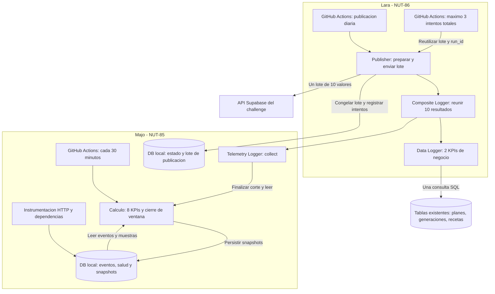

Work on Linear issue NUT-85:

Suggested branch name: mariajoserosalestorres/nut-85-implementar-telemetria-tablas-y-migracion-de-kpis-con-github

<issue identifier="NUT-85">
<title>Implementar telemetría, tablas y migración de KPIs con GitHub Actions</title>
<description>
## Objetivo y entrega de <issue id="62913d2c-b24f-4c29-a815-2dc92dd6956c" href="https://linear.app/nutria-lab2/issue/NUT-85/instrumentar-telemetria-y-salud-para-los-kpis-diarios">NUT-85</issue>

Responsable: Majo. Implementar la persistencia local completa, instrumentación, cálculo y GitHub Action de Telemetry. Ticket compañero: [NUT-86 — Lara](<https://linear.app/nutria-lab2/issue/NUT-86/implementar-data-logger-para-persistir-kpis-en-supabase>).

### Alcance propio y archivos

1. Crear las CINCO tablas/modelos y migración del esquema compartido de abajo; no delegar esas decisiones a Lara.
2. Instrumentar NestJS y wrappers de Gemini/Unsplash y demás llamadas externas reales. Una llamada HTTP completada genera una sola fila terminal; cada intento de dependencia queda separado. Instrumentar al nivel donde se ejecuta la llamada, no ambas capas simultáneamente.
3. GET /health: respuesta 200 {"status":"ok","database":"ok"} tras SELECT 1; 503 {"status":"error","database":"error"} si DB falla. Límite DB de health: 2s. No invocar IA ni exponer excepciones/credenciales. Health queda excluido de la instrumentación de tráfico.
4. El escritor de eventos usa timeout SQL de 100ms por escritura y espera acotada antes de continuar la respuesta; captura fallos y emite código técnico en logs. No dejar promesas de persistencia sin esperar en serverless ni bloquear indefinidamente el negocio. Si el runtime mata una operación antes del cierre, queda pending; no deducir timeout. Probar cierre también en errores y desconexión.
5. TelemetryLogger.collect(context) materializa/reutiliza los ocho snapshots final en transacción; usa el corte FIJO y devuelve solo sus ocho códigos. Periodicidad no significa "llamar ocho veces a un endpoint": cálculos sobre eventos reales de la DB.
6. No se requiere endpoint para exportar telemetría. Las Actions/scripts consultan directamente la DB mediante Prisma y el contrato de módulo. No copiar PII ni datos de dominio en tablas kpi\_.

### Action propia: .github/workflows/kpi-telemetry.yml

* on.schedule cron "\*/30 \* \* \* \*" UTC; workflow_dispatch con environment dev/prod, date opcional para recomputar previews históricos, y mode sample/finalize.
* schedule siempre prod; manual dev exige su GitHub Environment y DB correspondientes. Variables/secrets del contrato compartido.
* concurrency por ambiente para esta Action, cancel-in-progress=false; permissions contents:read; timeout-minutes:10. Checkout main/default branch, Node24, pnpm frozen-lockfile, generar Prisma antes del script. No ejecutar migrate dev/deploy ni seed dentro del cron.
* Comando de sample: pnpm --filter api kpi:telemetry --mode sample --environment prod. Registrar salud del bucket floor(nowUTC/30min) con tiempo real; consultar API /health con timeout5s y DB SELECT1 con timeout2s. Timeout/5xx observado es unhealthy; no ejecutar muestras antiguas para rellenar huecos.
* Una muestra de API y DB forma un solo kpi_health_sample por bucket. Si no se puede guardar porque DB cayó, la Action falla visiblemente; no crear una observación ficticia. Reejecutar bucket no modifica su muestra original.
* En sample: calcular preview del día local con end=min(ahora,21:00 de D), start=00:00 de D. Guardar los ocho previews en la misma transacción. Si todavía no existe intervalo positivo, solo guardar la muestra y salir. Snapshots preview pueden coexistir por cortes; no promediar previews para fabricar p95.
* Comando de finalize: pnpm --filter api kpi:telemetry --mode finalize --date D --environment prod. Rechazar corte futuro; realizar transacción repeatable read que inserte/reutilice los ocho final inmutables. No tomar una nueva muestra de health con timestamp falso de las 21:00.
* El código de finalize es el mismo que invoca TelemetryLogger.collect desde el Publisher; no esperar a que el scheduler de Majo y Lara arranquen simultáneamente.
* Cada corrida produce artifact de diagnóstico no sensible (ventana, cantidad de muestras, calidad, errores técnicos). Retention artifacts=90 días. Ante fallo de telemetría, exit no cero.
* Desde 01/01/2027 ejecutar la purga trimestral acordada sobre tablas crudas/previews/finales de períodos cerrados; DELETE por lotes de 1000 filas, sin tocar kpi_publication ni período en preparación. No purgar antes.

### Pruebas y aceptación propias

* Migración en DB vacía y DB con datos de NutrIA: existen cinco tablas, CHECK, UNIQUE e índices; recetas/planes/usuarios existentes no cambian.
* Rollback operativo: deshabilitar cron/instrumentación; conservar las tablas/datos, no revertir borrando producción. Aplicación funciona si se desactiva instrumentación.
* Eventos: 200, 404, 500, red, timeout confirmado, pending sin cierre, cierre duplicado; comprobar un id y duración >=0. Ruta sin query/userId/token. Retries externos producen filas por attempt.
* Fórmulas con fixtures deterministas: para 20 duraciones 1..20ms, p95=19ms; 1 timeout +1 server_error sobre10 operaciones => error20%, timeout10%; 2 fallos sobre8 intentos =>25%. 4xx no aumenta errores.
* Último éxito puede estar antes de start; salud desconocida/antigua sin éxito ni denominador produce unavailable LOCAL, que Lara convierte a0 EXTERNO. 0 observado conserva calidad distinta.
* Dos muestras saludables y una caída =>66.666...%; unknown no cuenta como healthy ni caída. Sin muestras =>unavailable.
* Bucket duplicado no altera salud; health/reporting no entran en tráfico; atraso de scheduler no cambia el corte.
* Dos finalizaciones concurrentes dejan exactamente8 finales iguales, completos e inmutables; no una mezcla de corridas.
* Fallo/lentitud de DB no bloquea indefinidamente negocio; Action señala errores y no informa datos inventados como observed.
* Una ejecución manual real en dev demuestra escritura/lectura de eventos/snapshots y entrega al contrato falso/real de Lara. Adjuntar comando, resultado y enlace de GitHub Actions al cierre.
* Fuera de alcance: UI, nuevos KPIs, cambios a tablas centrales o publicación externa.

## Contrato compartido v1 — obligatorio en <issue id="62913d2c-b24f-4c29-a815-2dc92dd6956c" href="https://linear.app/nutria-lab2/issue/NUT-85/instrumentar-telemetria-y-salud-para-los-kpis-diarios">NUT-85</issue> y <issue id="eec1f483-7251-4624-b435-93e05ffd2226" href="https://linear.app/nutria-lab2/issue/NUT-86/implementar-data-logger-para-persistir-kpis-en-supabase">NUT-86</issue>

Este texto sustituye el diseño anterior. Destino externo: API Supabase del challenge. Base operativa: PostgreSQL/Prisma existente de NutrIA. No migrar NutrIA a Supabase, no usar Dataverse, no crear tablas propias en el Supabase central.

### Responsabilidades y Mermaid



Majo crea TODAS las tablas nuevas y su única migración, incluida la tabla de publicación. Lara escribe/lee el estado de publicación y lee snapshots mediante la interfaz, sin una migración competidora. Cada rama puede desarrollarse con fixtures; la entrega integrada requiere ambos tickets. Composite recoge resultados; no duplica eventos ni envía a servicios externos. Solo Publisher publica.

### Ventana temporal y defaults acordados

Zona: America/Argentina/Buenos_Aires. Reportar el día D desde 00:00 inclusive hasta 21:00 exclusivo: un corte parcial, NO 24 horas ni el día anterior. Guardar instantes UTC y date como fecha local sin conversión. Ejemplo D=2026-10-09: start=2026-10-09T03:00:00Z y end=2026-10-10T00:00:00Z. Los hechos posteriores al corte no se agregan al lote aceptado.

Cron diario UTC: 0 0 \* \* \*. Si el scheduler se retrasa, tomar la fecha del último corte local de las 21:00 que ya pasó, no la fecha UTC ni una ventana corrida. Reintentos y ejecución manual fijan D explícitamente. Rechazar una fecha futura o un corte que todavía no ocurrió.

Siempre construir diez valores numéricos. Por dirección del equipo, falta de fuente, muestra o denominador produce value=0 EXTERNO y quality=defaulted con motivo LOCAL. No enviar string "null" ni null a la API. Un 0 medido conserva quality=observed. No describir defaulted como una observación ni afirmar que un 0 de salud defaulted prueba una caída. Un código duplicado/desconocido, un resultado NaN/Infinity o un contrato mal formado es un error de implementación: falla el armado, no se oculta con un default.

### Interfaz TypeScript y propietarios

Archivo compartido: apps/api/src/modules/kpi/kpi-contract.ts, implementado por Lara; Majo lo consume. Los tipos y las fórmulas siguientes son el acuerdo, no decisiones pendientes.

```ts
type KpiEnvironment = 'dev' | 'qa' | 'prod';
type KpiId =
  | 'operations_count' | 'error_rate' | 'latency_p95_ms'
  | 'health_status' | 'last_success_age_seconds' | 'timeout_rate'
  | 'dependency_error_rate' | 'availability_rate'
  | 'initial_plans_count' | 'manual_recipes_count';

interface CollectionContext {
  contract_version: '1';
  date: string; // YYYY-MM-DD en Argentina
  environment: KpiEnvironment;
  window_start: string; // ISO UTC
  window_end: string; // ISO UTC, corte fijo
  run_id: string; // UUID de la publicacion; no el ID numerico de Actions
}

interface KpiResult {
  kpi_id: KpiId;
  value: number | null;
  quality: 'observed' | 'unavailable';
  reason: string | null; // codigo tecnico corto, sin datos personales
  sample_count: number;
  measured_at: string; // ISO UTC real del calculo
}

interface KpiLogger {
  collect(context: CollectionContext): Promise<readonly KpiResult[]>;
}

interface Measurement {
  kpi_id: KpiId;
  date: string;
  env: KpiEnvironment;
  value: number;
  run_id: string;
}

interface FrozenBatch {
  contract_version: '1';
  context: CollectionContext;
  measurements: readonly Measurement[]; // exactamente diez, ordenados por kpi_id
  diagnostics: readonly {
    kpi_id: KpiId;
    quality: 'observed' | 'defaulted';
    reason: string | null;
    sample_count: number;
  }[];
  payload_sha256: string;
}
```

Telemetry devuelve exactamente los ocho códigos técnicos/salud; Data devuelve exactamente los dos de negocio. Composite espera ambas ramas, comprueba conjuntos disjuntos/completos, aplica defaults y arma las diez filas. Excepciones esperables de una fuente se traducen en unavailable para sus códigos y motivo SOURCE_UNAVAILABLE; fallos de programación/estructura se propagan. Nada de payloads con team_id, status, error_message o campos heredados de Dataverse.

### Esquema PostgreSQL local — dueño de migración: Majo

Todos los nombres nuevos llevan prefijo kpi\_. Implementar modelos Prisma con @@map a los nombres indicados. Timestamp: DateTime @db.Timestamptz(3); fecha: DateTime @db.Date; UUID: String @db.Uuid; importes/duraciones: Float @db.DoublePrecision; JSON: Json @db.JsonB. Enumeraciones del contrato se almacenan como texto con CHECK en la migración. PK/UNIQUE/índices también se reflejan en Prisma. Sin FK a usuario ni contenidos de negocio.

1. **kpi_http_event**
   * id UUID PK generado por aplicación; environment text NOT NULL; operation text NOT NULL (ruta normalizada).
   * started_at timestamptz NOT NULL; finished_at timestamptz NULL; duration_ms double precision NULL; http_status smallint NULL.
   * outcome text NOT NULL: pending, success, client_error, server_error, network_error, timeout, other.
   * recorded_at timestamptz NOT NULL default now().
   * CHECK environment IN(dev,qa,prod); duration_ms>=0 cuando exista; http_status entre 100 y 599; finished_at>=started_at.
   * pending implica finished_at y duration_ms nulos; terminal implica ambos completos. network_error/timeout pueden no tener http_status.
   * Índices (environment,finished_at), (environment,outcome,finished_at), (environment,started_at).
   * Insertar pending al comenzar y cerrar el MISMO id con UPDATE; no dos filas por solicitud.
2. **kpi_dependency_event**
   * id UUID PK; environment text NOT NULL; operation_id UUID NOT NULL (correlación técnica, sin FK obligatoria); dependency text NOT NULL; attempt integer NOT NULL >=1.
   * started_at timestamptz NOT NULL; finished_at timestamptz NULL; duration_ms double precision NULL; outcome text NOT NULL: pending, success, error, timeout; recorded_at timestamptz NOT NULL default now().
   * UNIQUE(environment,operation_id,dependency,attempt); índices (environment,finished_at) y (environment,outcome,finished_at).
   * Mismos CHECK de fechas/duración/pending que HTTP. Cada reintento tiene otro attempt/id; no guardar URL ni claves.
3. **kpi_health_sample**
   * id UUID PK; environment text NOT NULL; scheduled_for timestamptz NOT NULL (bucket de 30 minutos); measured_at timestamptz NOT NULL (observación real).
   * api_ok boolean NULL; database_ok boolean NULL; outcome text NOT NULL: healthy, unhealthy, unknown; reason text NULL.
   * UNIQUE(environment,scheduled_for); índice (environment,measured_at).
   * healthy requiere ambos true; unhealthy requiere al menos un false; unknown admite valores no comprobados y nunca se interpreta como healthy.
   * Reejecutar un bucket conserva su primera observación: ON CONFLICT DO NOTHING; no backfill de salud inventado.
4. **kpi_snapshot**
   * id UUID PK; environment text NOT NULL; report_date date NOT NULL; window_start/window_end timestamptz NOT NULL.
   * snapshot_kind text NOT NULL: preview o final; kpi_id text NOT NULL (uno de los ocho de Telemetry).
   * value double precision NULL; quality text NOT NULL: observed o unavailable; reason text NULL; sample_count bigint NOT NULL >=0; measured_at timestamptz NOT NULL.
   * UNIQUE(environment,report_date,window_end,snapshot_kind,kpi_id); índice (environment,report_date,snapshot_kind).
   * CHECK window_start<window_end; observed requiere value finito/no negativo; unavailable requiere value NULL y reason no vacío; porcentajes 0..100 y salud 0/1.
   * Cada cálculo inserta los ocho snapshots en UNA transacción. Preview idempotente por corte; final inserta una sola vez y es inmutable. Si ya existen ocho finales para ese contexto, devolverlos sin recalcular ni sobrescribir.
5. **kpi_publication**
   * run_id UUID PK; environment text NOT NULL; report_date date NOT NULL; window_start/window_end timestamptz NOT NULL.
   * status text NOT NULL: preparing, frozen, accepted, delivered, failed; frozen_batch jsonb NULL; payload_sha256 text NULL (64 caracteres hex); source_commit text NOT NULL.
   * retry_chain_id UUID NOT NULL; attempt_count integer NOT NULL default 0, CHECK 0..3 (por cadena automatica: inicial + dos reintentos); last_error text NULL (código técnico); created_at/updated_at timestamptz NOT NULL default now(); accepted_at timestamptz NULL; delivered_at timestamptz NULL.
   * UNIQUE(environment,report_date); índices (status,updated_at); window_start<window_end.
   * preparing permite lote nulo. frozen/accepted/delivered requieren lote y hash. accepted y delivered requieren accepted_at. failed puede ocurrir antes o después de congelar; si existe lote, nunca reemplazarlo.
   * Lara reserva fila por environment/date y reutiliza run_id ante conflicto; congela una vez en UPDATE condicional dentro de transacción. delivered requiere delivered_at. Reanudación de accepted/delivered o de cualquier fila con accepted_at solo verifica/omite publicación: nunca ejecuta otro POST ni prepara otro lote.
   * No almacenar claves en frozen_batch, diagnósticos ni last_error. Una recuperación manual explícita después de failed inicia otra retry_chain_id y reinicia attempt_count; conserva run_id, contexto, source_commit y lote congelado. No inicia otra cadena automática al agotarse la anterior.

Majo agrega índices createdAt en meal_plans y recipes para la consulta de Lara; el índice generationRunId de meal_plans ya existe. Crear una migración aditiva con las cinco tablas/CHECK/índices, generar Prisma y verificar deploy sobre una base nueva y otra con datos. No reset, seed ni DROP de tablas de negocio. Migraciones por prisma migrate deploy con DATABASE_URL_UNPOOLED si está disponible; no ejecutar migraciones desde cron de medición/publicación.

Retención: conservar eventos/samples/snapshots hasta 31/12/2026 inclusive. Desde 01/01/2027, la Action periódica purga en lotes el trimestre cerrado de esas cuatro tablas; no purgar el día en preparación ni kpi_publication. Publicaciones y artifacts quedan disponibles para trazabilidad. No borrar recetas/planes como parte de esta tarea.

### Los diez KPIs y fórmulas

Base HTTP: eventos terminales con finished_at en \[start,end), del ambiente; excluir /health y reporting. Requests todavía pending se diagnostican como incompletos: no son timeouts ni entran en la población de operaciones terminadas. Dependencias usan intentos terminales por finished_at. Duraciones y ratios deben ser finitos.

| Código | Rama / kind | Unidad API | Fórmula |
| -- | -- | -- | -- |
| operations_count | Telemetry / technical | {request} | Cantidad de operaciones HTTP terminadas en la ventana |
| error_rate | Telemetry / technical | % | (server_error + network_error + timeout) / operaciones × 100; sin denominador, unavailable |
| latency_p95_ms | Telemetry / technical | ms | percentile_disc(0.95) sobre duration_ms de operaciones terminadas; sin muestra, unavailable |
| health_status | Telemetry / health | 1 | Última muestra dentro de la ventana: healthy=1, unhealthy=0; unknown/sin muestra, unavailable |
| last_success_age_seconds | Telemetry / technical | s | end menos último finished_at 2xx conocido antes de end, incluso anterior a start; sin éxito conocido, unavailable |
| timeout_rate | Telemetry / technical | % | Timeouts confirmados / operaciones terminadas × 100; sin denominador, unavailable |
| dependency_error_rate | Telemetry / technical | % | (error + timeout) / intentos terminados × 100; sin denominador, unavailable |
| availability_rate | Telemetry / health | % | Muestras healthy / muestras healthy+unhealthy de ventana ×100; unknown/missing no son caídas; sin muestra válida, unavailable |
| initial_plans_count | Data / business | {plan} | Filas MealPlan creadas en ventana y todavía existentes al leer, con GenerationRun.kind=MEAL_PLAN_INITIAL y status=SUCCEEDED |
| manual_recipes_count | Data / business | {recipe} | Filas Recipe creadas en ventana, origin=MANUAL y todavía existentes al leer |

Último éxito y salud toman máximo tiempo real, no orden de inserción. health_status queda unavailable si la última muestra conocida es de más de 60 minutos antes del corte (dos intervalos de muestreo). Disponibilidad es muestreo, no uptime continuo. No incluir daily_active_users ni adherencia.

Data lee ambas cuentas con UN SOLO SELECT de subconsultas escalares, parametrizado por Prisma $queryRaw; no concatenar SQL ni cargar colecciones en memoria. No filtrar isCurrent: un plan inicial creado y luego supersedido sigue contando si la fila existe. Son conteos del estado transaccional disponible, no un log histórico de registros borrados. No ejecutar seed/importaciones durante la medición: el modelo actual no distingue sus altas MANUAL de las reales; no afirmar esa distinción sin fuente.

### API externa y configuración fija

Fuentes: [guía](<https://github.com/lab4-kpis/kpis/blob/main/docs/TEAM_GUIDE.md>), [OpenAPI dev](<https://lab4-kpis.github.io/kpis/dev/openapi.yaml>), [OpenAPI prod](<https://lab4-kpis.github.io/kpis/openapi.yaml>).

* dev: SUPABASE_URL=[https://gapkrqfdshqbowdtldzc.supabase.co](<https://gapkrqfdshqbowdtldzc.supabase.co>).
* prod: SUPABASE_URL=[https://rzlalzowistpiphmdqpp.supabase.co](<https://rzlalzowistpiphmdqpp.supabase.co>).
* qa es un ambiente válido del contrato, pero NO habilitarlo automáticamente: no hay servidor/credenciales qa entregados en esta tarea.
* GitHub Environments dev/prod: secrets DATABASE_URL, DATABASE_URL_UNPOOLED (solo migración), PROJECT_KEY; variables SUPABASE_URL, SUPABASE_PUBLISHABLE_KEY, KPI_ENV, KPI_API_BASE_URL.
* Backend instrumentado: DATABASE_URL y KPI_ENV obligatorio. No inferir ambiente a partir de NODE_ENV. La Action lee/escribe la DB asociada a ese environment, no mezcla muestras de otro.
* Claves Supabase pública y privada deben corresponder al servidor/ambiente. Validar identidad por POST /rest/v1/rpc/current_project con {} sin imprimir respuesta sensible. No service_role ni conexión PostgreSQL central.
* POST /rest/v1/measurement?on_conflict=project_id,kpi_id,date,env con apikey, X-Project-Key, Content-Type application/json, Prefer resolution=ignore-duplicates.
* Enviar exactamente diez objetos Measurement; NO diagnostics/context/hash/quality. Una respuesta POST 2xx cierra la cadena de publicación inmediatamente: marcar accepted/accepted_at y no despachar ni ejecutar otro intento. Conservar la confirmación y luego verificar por GET los diez valores antes de marcar delivered. Una falla de esa lectura solo queda pendiente de verificación; no habilita otro POST.
* Reenvío ignora duplicados: no corrige números. Si GET devuelve un valor distinto del lote congelado, marcar failed/REMOTE_VALUE_CONFLICT y no intentar reemplazarlo.
* Catálogo vía kpi_catalog: id, kind, unit, description obligatorios; description 5..500 caracteres; máximo diez activos por ambiente. Definiciones en archivo versionado, con descripción de fuente/fórmula y corte parcial, source y justification. No usar aggregation=avg para p95; omitir aggregation (opcional), ya se publica el escalar diario calculado.
* Un comando manual registra solo definiciones faltantes; verifica id/kind/unit y detecta otros activos. No borrar/renombrar/retirar catálogo automáticamente. Discrepancia de catálogo es fallo definitivo.
* HTTP timeout de catálogo/envío/lectura=15s; abortar petición al vencer. No imprimir claves, URLs con credenciales, perfiles o datos personales.
* 400/401/403/409: fallo definitivo de contrato/credenciales, sin cadena automática inútil. Red/timeout/408/429/5xx: transitorios, como máximo tres intentos totales (inicial + dos reintentos con backoff de 5 y 10 minutos). Un POST 2xx detiene siempre la cadena; no hay tercer reintento ni espera de 20 minutos. Respetar Retry-After si es mayor que el backoff base.
* No modificar el backend para publicar KPIs en cada petición; publicación ocurre solo desde GitHub Actions.

### Coordinación de archivos y esfuerzo

Lara: kpi-contract.ts, composite/data/publisher, catálogo, CLI publisher/retry/register-catalog, workflows kpi-publish.yml y kpi-retry.yml; cambios de package.json para TODOS los comandos y tsx como devDependency explícita (sin npx descargando latest).
Majo: modelo Prisma kpi.prisma y migración, repositorio telemetría/snapshots, instrumentación/health/calculador, CLI telemetry, workflow kpi-telemetry.yml. Todos los módulos nuevos bajo apps/api/src/modules/kpi y scripts bajo apps/api/scripts/kpi.
Comandos acordados del paquete api: kpi:telemetry, kpi:publish, kpi:retry, kpi:catalog; scripts ejecutados con tsx. Majo entrega su script y Lara agrega la entrada de package.json para evitar cambios competitivos en el mismo archivo. Usar Node 24 y pnpm como el CI actual.

Estimación de esfuerzo del equipo: 6 horas-persona totales, no 6 por ticket ni conversión automática de 4/3 puntos. Es estimación, no trabajo registrado. Si amenaza el plazo vigente, PM suma al frontender para implementación/pruebas. Mantener las fechas actualmente configuradas en Linear. Desarrollo de código pendiente: esta descripción no acredita implementación ni despliegue.
</description>
<team name="NutrIA"/>
<label>feature</label>
<label>backend</label>
<project name="NutrIA MVP">AI-powered web app that creates weekly meal plans, recipes, and shopping lists tailored to user goals, preferences, and restrictions.</project>
<issue-relations><related><issue-ref identifier="NUT-86" title="Implementar Publisher, Composite y KPIs de negocio con Actions y retries"/></related></issue-relations>
</issue>